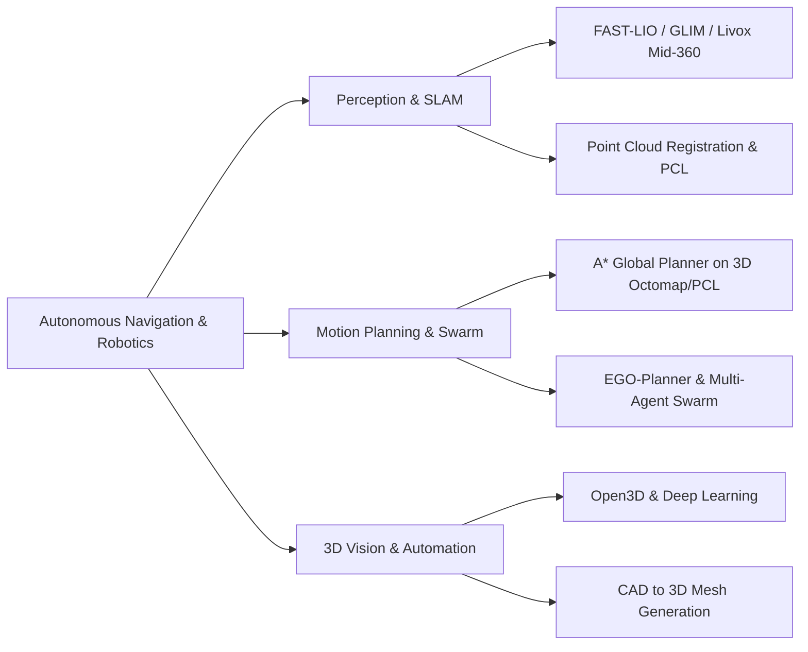

# Hi there, I'm Pengfei Deng (lkpopo) 👋

  
  
  

---

### 👨‍💻 About Me

I am a robotics engineer and software developer passionate about **Autonomous Robotics**, **3D Spatial Intelligence**, and **High-Performance Engineering**.

- 🤖 **Focus Areas**: LiDAR-Inertial Odometry (LIO), SLAM, 3D Point Cloud Processing, and Autonomous Path Planning.
- 🔭 **Working On**: Next-generation 3D spatial mapping, multi-agent swarm trajectory planning, and robotics software deployment on ROS/ROS2.
- 💡 **Core Interests**: Integrating deep learning with classical 3D vision, high-speed robot navigation, and full-stack automation.
- ⚡ **Fun Fact**: Turning complex mathematical models into efficient real-time C++ code is my superpower.

---

### 🛠️ Tech Stack & Tooling

#### Programming & Frameworks

#### Robotics, Point Cloud & Math

#### Environment & Development Tools

---

### 🚀 Key Focus & Research Areas

- 📡 **LiDAR-Inertial SLAM**: High-performance real-time state estimation with Solid-State & Mechanical LiDAR (Livox Mid-360, HAP, Velodyne) integrated with IMU.
- 🎯 **3D Path Planning**: Trajectory generation and real-time obstacle avoidance under complex 3D environments.
- 📐 **CAD & Geometric Processing**: Algorithmic pipeline transforming 2D CAD drawings into structured 3D spatial models.
- 🤖 **Agent & Automation Systems**: Autonomous workflow tools, script automation, and AI content publishing.

---

### 📊 GitHub Statistics

  

---

💡 *"Continuous learning, solid engineering, and turning vision into reality."*

📫 Feel free to reach out for robotics, SLAM, and software collaboration!

